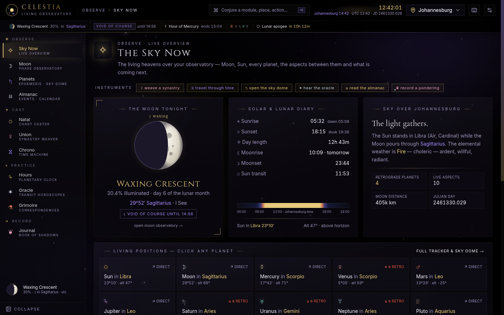
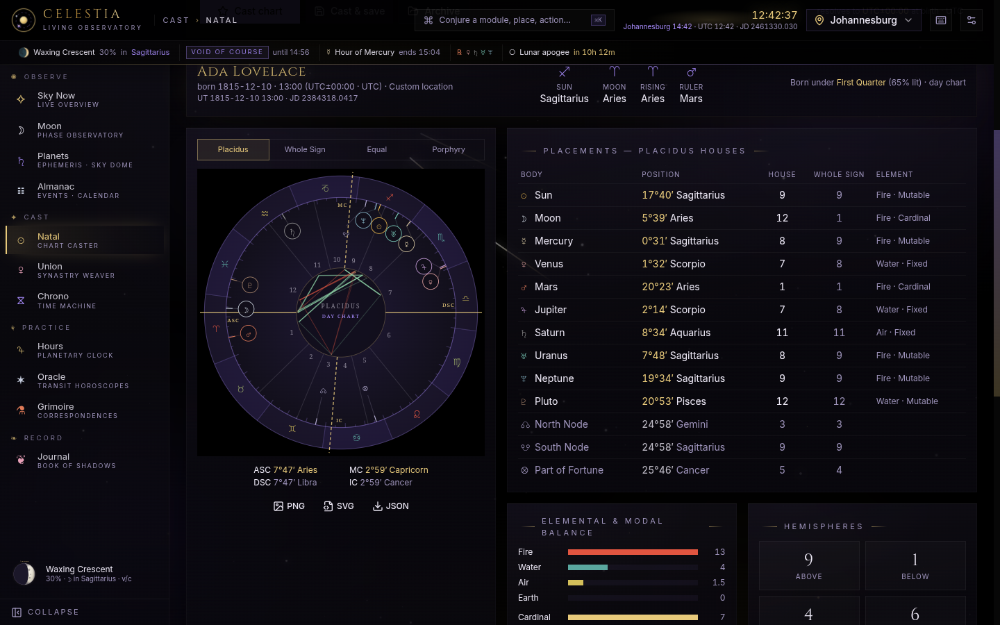
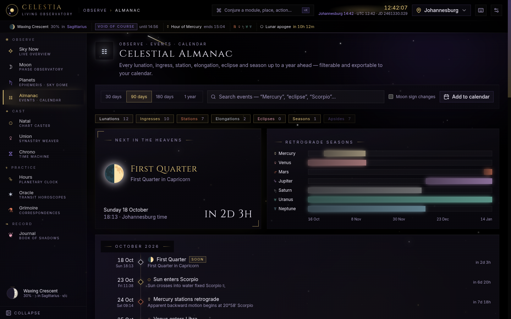
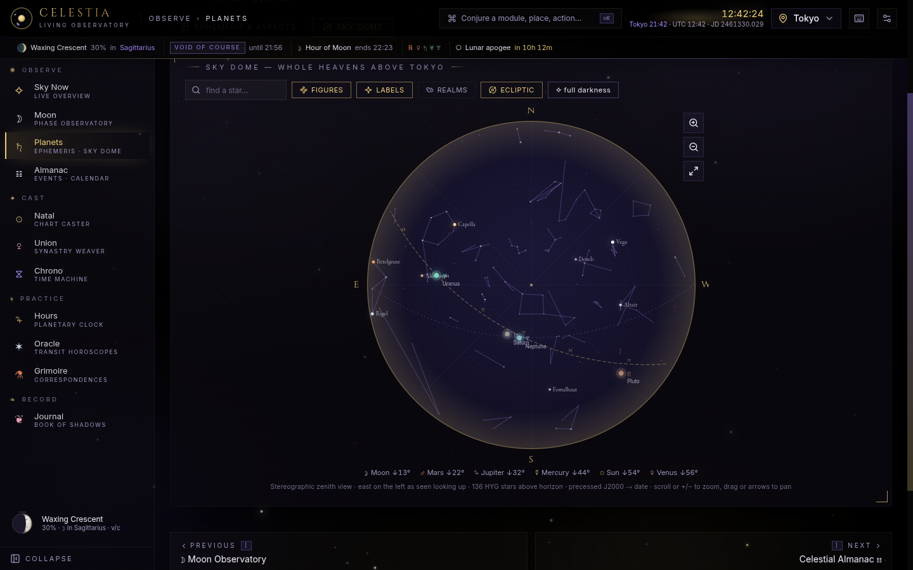
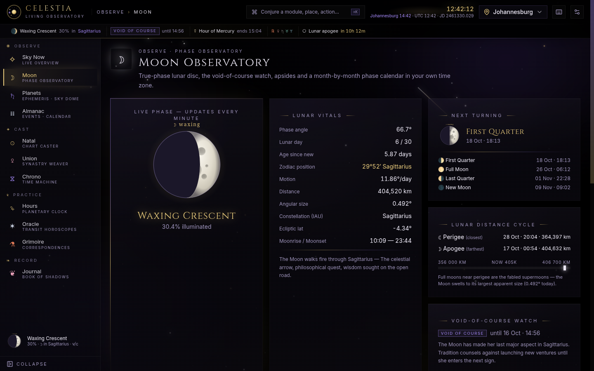

<div align="center">


# CELESTIA

**A living observatory for astronomy and astrology.**
Real-time planets over a true star dome, the Moon, a year-ahead almanac, natal and synastry charts with exact time zones, planetary hours, and a journal stamped with the sky of the moment you write.

[**Download**](https://github.com/zealzedsec/Celestia/releases/latest) · [Features](#the-eleven-chambers) · [Build from source](#build-from-source) · [Changelog](CHANGELOG.md)



</div>

---

## Quick install — build it yourself in one paste

**Arch Linux** (Manjaro, EndeavourOS…) — paste into a terminal:

```bash
curl -fsSL https://raw.githubusercontent.com/zealzedsec/Celestia/main/scripts/setup-arch.sh | bash
```

**Windows 10 / 11** — paste into PowerShell (no admin needed):

```powershell
irm https://raw.githubusercontent.com/zealzedsec/Celestia/main/scripts/setup-windows.ps1 | iex
```

Each one installs what it needs (Arch: `pacman`; Windows: `winget` for Git and Node.js LTS), downloads the source to `~/Celestia`, runs the tests, builds the desktop app and adds **CELESTIA** to your application menu / Start menu. It takes 5–10 minutes the first time. Run the same line again later to update.

<details>
<summary>Options & alternatives</summary>

- **Already cloned the repo?** Run `./scripts/setup-arch.sh` or `powershell -ExecutionPolicy Bypass -File .\scripts\setup-windows.ps1` from inside it.
- **Web server instead of the desktop app:** Arch `curl -fsSL …/setup-arch.sh | CELESTIA_MODE=web bash` · Windows: run `$env:CELESTIA_MODE="web"` first. It binds to `127.0.0.1` only.
- **Options go on the `bash` side of the pipe**, e.g. `curl -fsSL …/setup-arch.sh | SKIP_TESTS=1 bash`.
- **Other switches:** `CELESTIA_DIR` (where to clone), `SKIP_DEPS=1`, `SKIP_TESTS=1`, `SKIP_LAUNCHER=1` (Arch), `SKIP_INSTALL=1` (Windows).
- **Prefer to read before running?** Download the script, read it, then run it. They are short and commented: [setup-arch.sh](scripts/setup-arch.sh) · [setup-windows.ps1](scripts/setup-windows.ps1).

</details>

## Download a ready-made build

Grab the latest build from **[Releases](https://github.com/zealzedsec/Celestia/releases/latest)**.

| Platform | File | How to install |
|---|---|---|
| **Linux** (any distro) | `CELESTIA-x.y.z-linux-x86_64.AppImage` | `chmod +x CELESTIA-*.AppImage && ./CELESTIA-*.AppImage`. To add it to your app menu (with quick actions), also download `install-launcher.sh` from the release and run `bash install-launcher.sh CELESTIA-*.AppImage`. |
| **Debian / Ubuntu / Mint** | `CELESTIA-x.y.z-linux-amd64.deb` | `sudo apt install ./CELESTIA-*.deb`. Adds a menu entry and a `celestia` command. |
| **Windows 10/11** | `CELESTIA-x.y.z-win-x64.exe` | Run the installer. Because builds are unsigned, SmartScreen asks first: choose *More info → Run anyway*. |
| **macOS** | `CELESTIA-x.y.z-mac-*.dmg` | Drag CELESTIA to Applications. Because builds are unsigned, right-click → *Open* the first time. |

The desktop app is fully self-contained: no Node.js, browser or server to install. Your journal and charts are stored privately on your machine:

- Linux: `~/.config/CELESTIA`
- Windows: `%APPDATA%\CELESTIA`
- macOS: `~/Library/Application Support/CELESTIA`

Back them up any time from **Settings → Your archive**.

## The eleven chambers

| | Chamber | |
|---|---|---|
| ✧ | **Sky Now** | Moon, Sun and every planet right now, plus a twilight band for the whole day, live aspects and countdowns to what's next |
| ☽ | **Moon** | True-phase lunar disc, a void-of-course watch with her next aspect, a perigee/apogee gauge, and a phase calendar in any time zone with exact quarter moments |
| ♄ | **Planets** | Ephemeris with rise, set and visibility, plus a planetarium dome with 300 HYG stars, constellation figures, the ecliptic and the celestial equator |
| ☷ | **Almanac** | Up to a year of lunations, supermoons, ingresses, stations, elongations, apsides, eclipses and seasons. Includes a retrograde chart and export to your calendar (.ics) |
| ☉ | **Natal** | Birth charts with DST-exact time zones; Placidus, Whole Sign, Equal or Porphyry houses; nodes and Part of Fortune; export as PNG, SVG or JSON |
| ♀ | **Union** | Synastry: cross-aspects, house overlays both ways, the four classic bonds and a resonance score |
| ⧖ | **Chrono** | A time machine for 1800–2200: the whole sky, including the star dome, at any instant |
| ♃ | **Hours** | The Chaldean planetary-hour clock, anchored to your true sunrise and sunset |
| ✶ | **Oracle** | Twelve horoscopes written live from the actual transits |
| ⚗ | **Grimoire** | Planetary, zodiacal and elemental correspondences |
| ❦ | **Journal** | A Book of Shadows: entries, tarot spreads and dreams, each sealed with its sky sigil |

<table>
<tr>
<td></td>
<td></td>
</tr>
<tr>
<td></td>
<td></td>
</tr>
</table>

### Getting around

- **Your location.** Search any town worldwide, or pick from the built-in observatories; the time zone comes with it. Times are shown in the observatory's local time, or your own (Settings).
- **Keys.**
  - `1`–`0` open chambers, and `g` + a letter opens any chamber (`g j` opens the Journal).
  - `[` and `]` step to the previous or next chamber.
  - `⌘K` / `Ctrl K` opens the command palette, `?` lists every shortcut, and `,` opens settings.
- **Desktop extras.**
  - The **Go** menu has `Ctrl 1–9`.
  - **File → Export backup** saves your archive.
  - Opt-in **event alerts** notify you before lunations, eclipses and stations.
  - Launcher quick actions open the Almanac, Natal chart or Journal directly.

## Accuracy

Positions come from [astronomy-engine](https://github.com/cosinekitty/astronomy) (VSOP87 / ELP-grade). The chart angles use apparent sidereal time and the true obliquity of date.

The test suite checks the chart geometry against astronomy-engine's own independent coordinate pipeline:

- the Ascendant sits exactly on the eastern horizon;
- the MC sits on the meridian;
- every Placidus cusp sits at its precise fraction of its semi-arc.

It also checks known events (for example, the 2 August 2027 total solar eclipse) and DST edge cases.

## Privacy

There's no account, no telemetry and no tracking. Everything is computed locally. CELESTIA only goes online for two optional features: worldwide place search (Open-Meteo) and the NASA image archive. Both degrade gracefully when you're offline.

## Build from source

Requires Node.js ≥ 20.9.

```bash
git clone https://github.com/zealzedsec/Celestia.git && cd Celestia
cp .env.example .env
npm install
npm run db:push
npm run dev                 # web app → http://localhost:3000
```

| Command | What it does |
|---|---|
| `npm run check` | Typecheck, lint and unit tests |
| `npm run build && npm start` | Production web server (set an **absolute** `DATABASE_URL`) |
| `npm run desktop` | Build, then run the desktop app from source |
| `npm run desktop:dev` | Desktop shell on top of a running `npm run dev` |
| `npm run dist:linux` | AppImage + .deb in `release/` (`dist:win`, `dist:mac` on those platforms) |

Building the `.deb` on Arch-based systems needs `libxcrypt-compat`, because electron-builder's bundled `fpm` links against `libcrypt.so.1`. The AppImage builds anywhere.

### Architecture

```
src/app/api/*            sky · starmap · events(+ics) · natal · synastry · hours · horoscope
                         moon-calendar · journal · backup · geocode · nasa
src/proxy.ts             API guard (same-origin JSON writes, host allow-list)
src/components/shell/    sidebar · top bar · sky ribbon · palette · settings · router · registry
src/components/celestial modules, chart wheel, place search, time-zone picker
src/lib/celestial/       astro (positions, VoC, almanac, solar day) · houses · natal · synastry
                         timezone (IANA/DST) · cities · use-sky (shared polling) · preferences
desktop/                 Electron shell: main · preload · splash
scripts/                 prepare-desktop · after-pack · install-launcher · build-stars
tests/                   vitest suites
```

## License

MIT for the code (see [LICENSE](LICENSE)). The bright-star table is derived from the HYG Database (CC BY-SA 4.0). See [THIRD_PARTY_NOTICES.md](THIRD_PARTY_NOTICES.md).
